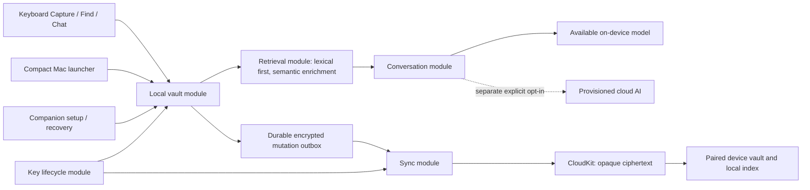

# Consumer backend and Mac launcher — proposed execution plan

Latest refinement: the human's core-memory brief now requires a persistent movable Mac entry and emphasizes Capture/Find plus local-resident sync. See [core MVP scope](../../../docs/MVP-CORE.md) and its pending scope answer before publishing this breakdown. The Chat/reminder/resurfacing release boundary is being reconsidered; existing work is preserved. Engine choices also need the keyboard-process and multimodal checks in the new research reports.

Status: draft for ticket-granularity review. The human requested a state-machine walkthrough before approval; an overall positive response is not approval to publish the revised tickets. The 22 October product instructions below are authoritative; implementation choices and numeric budgets remain proposals until verified. Existing tickets and their incomplete acceptance evidence remain intact.

## Product corrections from the human

- Mac hotkey opens a compact Spotlight/Raycast-style Find bar, with results changing as letters are typed. The large workspace/settings page is no longer the default Mac presentation.
- Place the Mac bar near the active text field when the host exposes usable geometry and the person permits access. Keep it within the screen. Fall back to a compact, predictable location without blocking use or claiming universal host support.
- The phone remains keyboard-first with Capture by default. Keyboard Find also updates during typing. Do not revisit the accepted dormant-host-caret limitation.
- Search must be useful immediately after capture, offline, with exact and approximate remembered wording. Chat/model setup is never a prerequisite for Find.
- Ordinary users see product choices and understandable availability/status. They do not configure server URLs, model identifiers, database terminology or inference daemons. The present Ollama adapter is development plumbing that must be replaced or isolated from the consumer experience.
- Private sync, speed and security are product requirements. A service-unreadable promise applies regardless of a user's optional Apple account settings. A completed upload, a visible result and an assistant answer are separate facts.
- Prefer suitable maintained open source over rebuilding standard behavior. Preserve working typing/routing while evaluating a reusable key plane. Choose Rust after a measured need or an applicable existing module establishes a benefit.

## Current evidence and gaps

The current native foundation preserves saved originals and has tested checklist/reminder operations. It rewrites a plaintext local JSON vault; it has no implemented encrypted sync or device key lifecycle. Find recomputes every note embedding on the main actor per query, scans/sorts the corpus and can be evaluated twice per render. Keyboard edits currently retain a query without necessarily rendering fresh results per letter. These are explicit development gaps, not a secure/fast release claim.

The synthetic public-interface probe took approximately 0.95–1.04 seconds per query in Debug with 100 notes; Release took 0.82–0.89 seconds at 100 and 8.71–8.98 seconds at 1,000. These are development-host characterization samples, not percentiles or representative semantic quality. [Source, conditions and reproduction](../../../docs/verification/search-baseline-2026-10-22.md) are retained. Real-device scaling and judged quality remain to be measured.

## Proposed five slices

| Ticket | Blocked by | Complete observable outcome |
| --- | --- | --- |
| 09 — Save and instantly refind in protected local storage | 01 (resolved) | A capture migrates/saves without changing its original, becomes searchable immediately, and Find returns bounded word/prefix matches while typing in keyboard and Mac. Storage, FTS/index journals and temporary copies share the local protection policy. Restart/crash/concurrent app-extension writes preserve data. Establish Release latency/memory baselines. |
| 10 — Recover meaning without a chat server | 09 | Precomputed, revisioned embeddings enrich fast lexical results. Long-note details and retained chat stay source-linked; stale queries/deleted content cannot reappear. A held-out exact/paraphrase/mixed-language suite selects the on-device encoder based on quality, latency and extension memory. |
| 11 — Invoke the compact Mac bar beside the current field | 09 | The hotkey opens/focuses Find in a small bar, results update while typing, arrows/Return/Escape work, and Capture/Chat remain nearby without destroying drafts. Position uses permitted focused-field geometry and a screen-clamped fallback. Consumer settings expose no inference-server setup. Pilot a suitable key-plane library separately before touching accepted iPhone routing. |
| 04 — Continue a remembered chat without developer setup (refined existing ticket) | 10, 03 | The person uses supported on-device AI with app-managed availability/setup or deliberately opts into a separately provisioned cloud option. Ordinary/Temporary/Forget semantics, source attribution and explicit reminder edits work through the same vault. No hidden remote fallback, fake response or model-generated claim of an unexecuted action. |
| 05 — Save offline and receive the same private capture on another device (refined existing ticket) | 09; real signing/account/device prerequisites | Per-record encrypted changes flow from a durable outbox through CloudKit to a paired device, update its local Find and reconcile reminders. Pairing/recovery/revocation/account isolation, conflicts and deletion are tested. Only ciphertext and required opaque transport metadata reach the sync provider. Foreground speed is measured separately from best-effort suspended/background delivery. |

Ticket 08's release gate would include 09–11. Existing media 06, deferred resurfacing 07 and the open native checks in 03 remain visible; none becomes completed through this plan. The proposed removal of 04 as a sync blocker reflects that sync does not require a working LLM. New tickets will be published only after the human reviews this breakdown, per the to-tickets skill.

## Modules and interfaces

- **Local vault:** durable capture/change/read operations; exact originals, authored structure, transactionally consistent lexical data and outbox. JSON is migration input, with recoverable validation; migration must not destroy the only copy. Encryption must also cover FTS terms, snippets, vectors, WAL/journal files and backups. Select a maintained encrypted database/library after a small target-compatible build and recovery pilot; do not invent a cipher or promise secure SSD erasure.
- **Retrieval:** apply revisioned changes/tombstones, return bounded batches for a query and resolve current originals. Hide database/model/chunk/vector choices. Publish lexical first, then semantic, outside the UI actor; check request and source generation before publication. Index once per content/model revision. Use BM25 plus prefix/exact matches as the lexical candidate; model quality is separately judged.
- **Key lifecycle:** create/store device/vault keys using platform facilities and vetted cryptographic libraries. Define trusted-device enrollment, lost-device revocation, key rotation and recovery before shipping sync. No recovery promise that requires the provider to hold a readable vault key. Existing iCloud Keychain candidate and explicit pairing/recovery alternatives need a recorded threat-model decision and review.
- **Sync:** durable per-record queue, retry/backoff/batching, authenticated encrypted envelopes, conflict policy/tombstones, account namespace, state persistence. Foreground requested send/receive can be accelerated; the OS decides suspended execution. Never block local save/search on networking.
- **Conversation:** owns attribution, retained/Temporary exchange state and explicit executed tools. Model availability/download/provider details stay behind its interface. Search runs independently. An unsupported on-device chat configuration needs an honest consumer state; a developer server is not the fallback.
- **Launcher:** owns hotkey/window/focus/geometry and input/result presentation. Read host geometry only for positioning, before activating our panel; avoid collecting surrounding host text. Accessibility permission is optional, deliberately explained and requested at action time. No Accessibility permission is required merely to register the current Carbon shortcut.

## Proposed performance acceptance budgets

These are targets to validate, not achieved claims. Use Release builds on named real devices, realistic 1k/10k/100k corpora, cold/warm measurements, p50/p95/p99 and memory/energy/termination observations.

| Path | Initial budget |
| --- | --- |
| Typing responsiveness | No search-induced main-thread stall over a frame; p95 input handling <8 ms |
| Warm query → first visible lexical matches, 10k captures | p95 <50 ms; p99 <100 ms, including scheduling/UI work |
| Warm query → semantic-enriched results, 10k captures | p95 <150 ms; p99 <300 ms |
| Cold keyboard/bar → first usable matches | p95 <300 ms; no dependency on model download |
| Local accepted save → same-process lexical visibility | Immediate read-after-save; active second-process refresh p95 <100 ms |
| Short capture → semantic-ready while execution is available | p95 <2 s; suspension/deferred work stated separately |
| Small text save → visible on another foreground, online, paired device | initial p95 <2 s in controlled network tests; report server/OS/network tails |
| Retrieval quality | >=100 held-out judged queries; exact recall@5 >=99%, paraphrase recall@5 >=90% starting targets; inspect mixed-language/long-note failures |

Do not weaken relevance/privacy silently to hit latency. Record misses, false matches and stale publications along with timings. No absolute speed promise for offline peers, OS-suspended apps, revoked accounts or unavailable assets.

## Tests and review

Retain the three human-approved public seams: keyboard workspace behavior; saved vault/retrieval/chat/reminder behavior; encrypted replication between two vaults. The revised storage/index implementation is exercised through the saved-vault interface, without private-SQL assertions. Use source-preserving migration, crash/restart, concurrent writer, latest-query, edit/delete-during-index and retained-vs-Temporary tests. Performance characterization measures that same caller path; native keyboard/hotkey/focus/geometry and actual two-device CloudKit behavior remain separate evidence.

Use red→green one behavior at a time. Review Standards and Spec against the already approved c319917 baseline, with the revised spec as the behavioral source. No new seam is proposed. Real-account provisioning and optional Accessibility/AI permissions will be requested only when a concrete setup is ready. Security release gates include threat-model review, current dependency/advisory checks, plaintext-leak checks, key/recovery/revocation tests and external cryptographic review before a strong audited-security claim.

## Decisions left to executable pilots

- Encrypted local database adapter and its target/compiler/extension compatibility.
- Embedding encoder/runtime, language coverage, chunking and memory margin.
- Whether a reusable open-source key plane improves the current accepted keyboard without regressing routing/selection.
- On-device chat compatibility and a managed cloud option's provider/operations; no provider is silently selected.
- Key establishment/recovery method and provider-visible metadata disclosure.

Rust is permitted if a specific measured module benefits; the first experiment removes repeated embedding/full scans/UI work before a language migration. Resurfacing ranking remains explicitly deferred and outside these decisions.
