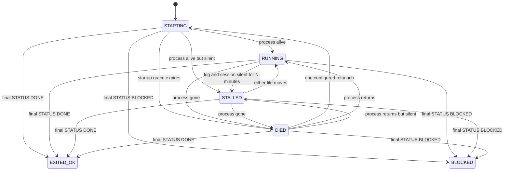

# Job watchdog

`tools/watchdog.py` checks files and processes with Python's standard library. It makes no model or network calls. `factory/` does not exist on main, so the script lives under `tools/`.



Poll once from cron, or keep a watcher running:

```sh
python3 tools/watchdog.py /tmp/job-watch.json --state /tmp/job-state.json
python3 tools/watchdog.py /tmp/job-watch.json --state /tmp/job-state.json --watch --interval 30
```

Example config (use absolute paths):

```json
{
  "name": "factory-fast",
  "log_path": "/tmp/job.log",
  "pid_file": "/tmp/job.pid",
  "result_path": "/tmp/job-result.md",
  "session_path": "~/.codex/sessions/2026/10/24/rollout-JOB.jsonl",
  "stall_minutes": 10,
  "startup_seconds": 60,
  "relaunch": ["/absolute/path/relaunch-job.sh"]
}
```

Use the exact rollout file for this job under `~/.codex/sessions/`, or its conversation JSONL under `~/.claude/projects/`. The caller supplies that path when starting the job; scanning other sessions could hide a stall. A missing heartbeat ages from the watcher start time. A fresh session keeps the job RUNNING even when its log is quiet. This detects file silence, not useful progress.

Replace `pid_file` with `process_match` for a literal command substring. Choose a unique match; a PID file is safer. Zombies count as dead. Set `startup_seconds` for the wrapper's launch delay. The first observation emits STARTING unless a final result is already present.

The final nonblank result line must be exactly `STATUS: DONE` or `STATUS: BLOCKED` with an optional space and reason. A final result wins even while the process is alive. EXITED_OK and BLOCKED remain terminal until the caller uses a fresh state file. Each new job needs fresh result/state files and its own session path.

State is atomically persisted as JSON. Only a state change prints one JSON event, containing name, previous/current state, time and relaunch count. Repeated polls are silent. Logs, sessions, command arguments, result reasons and exception details are never printed. Keep secrets out of the job name. Invalid config/state produces a fixed stderr error and exit code 2. An advisory lock prevents overlapping CLI observers from spending the relaunch budget twice.

`relaunch` is optional trusted argv, with no shell expansion. Only DIED can trigger it; a live STALLED job needs inspection before another writer is started. The wrapper must start the replacement job, atomically update the PID file, and use the configured log/session/result paths. Its output is discarded. One attempt is recorded before launch, including a failed launch, and survives observer restarts. Do not clear state to retry the same job. The watcher never kills jobs or wakes an agent itself; the caller can wake one only when it receives an event.

Verify: `python3 -m unittest discover -s tools/tests -v`.
