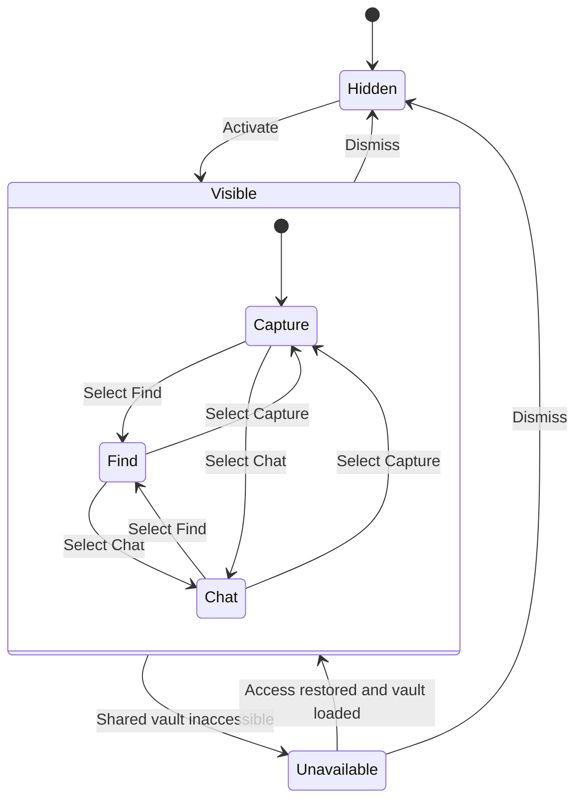
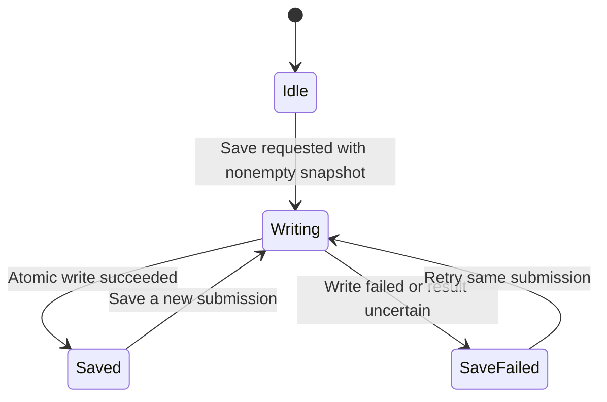
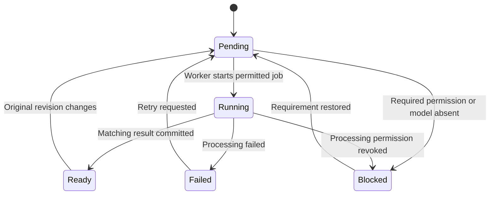
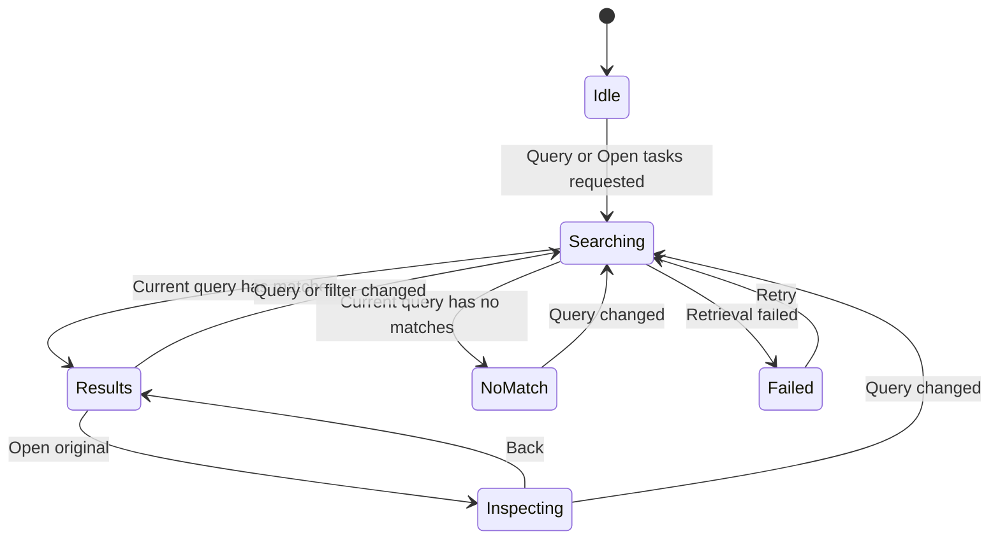
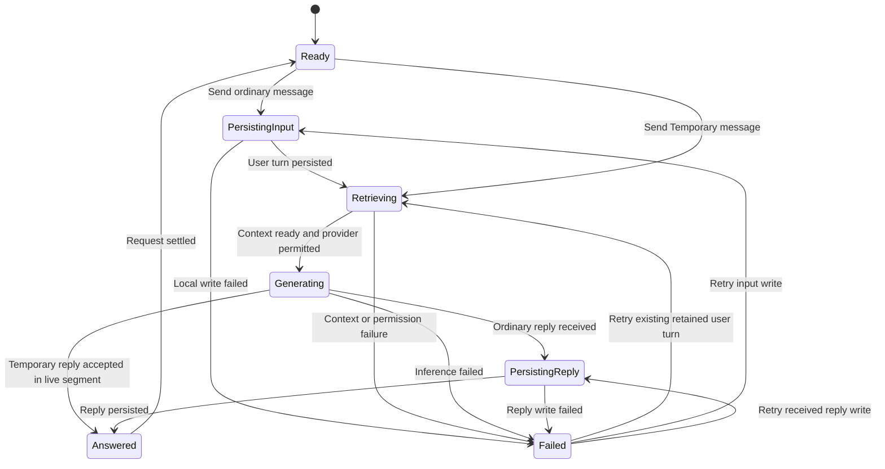
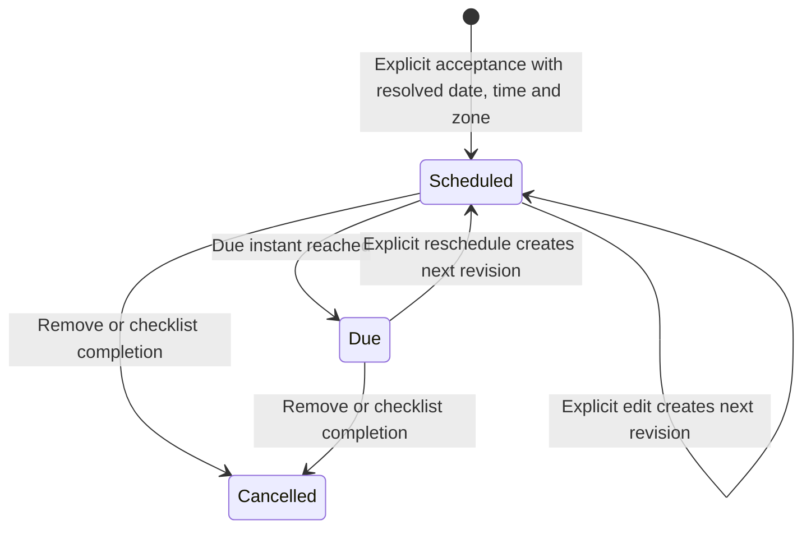
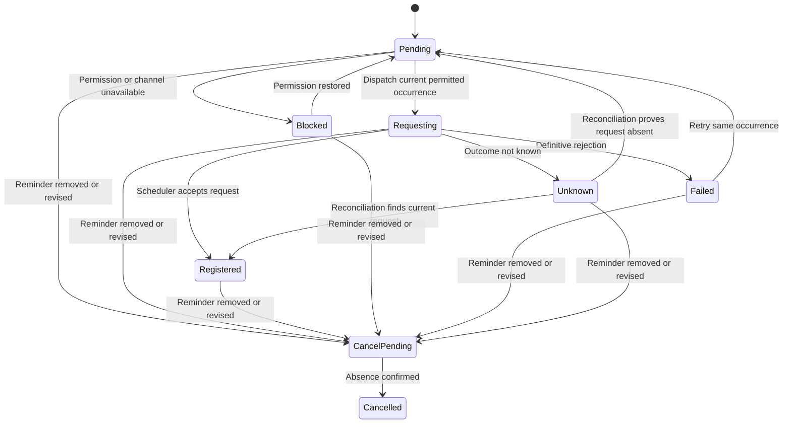
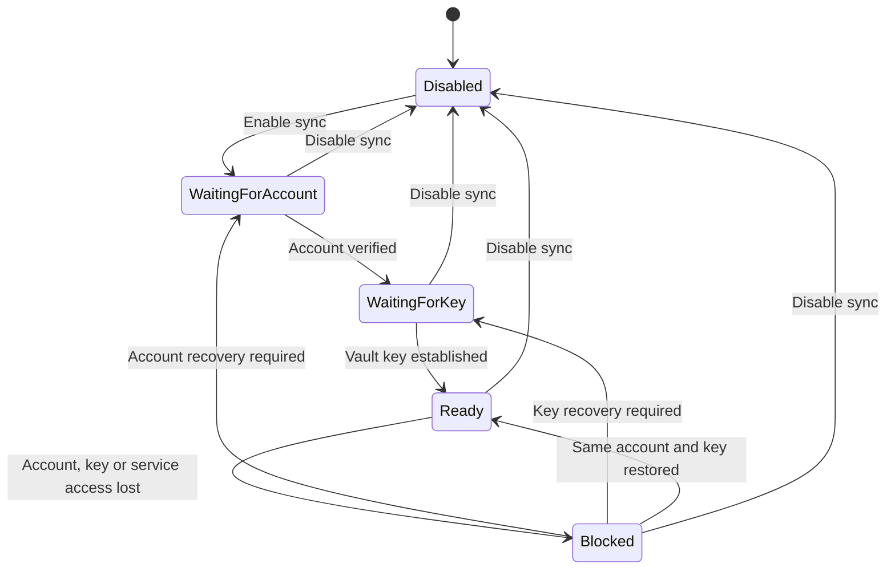
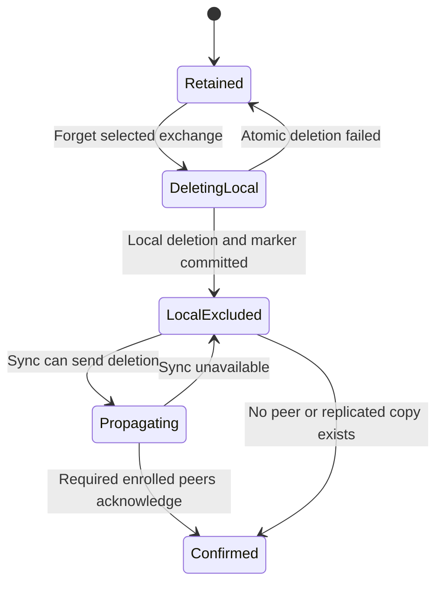
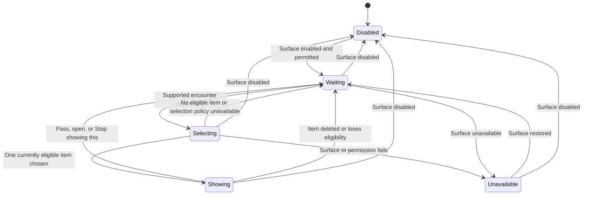

# Product state machine

Build a hierarchical state machine with independent regions for the workspace, saving, processing, retrieval, conversation, commitments, private sync, forgetting, and resurfacing.

**Status:** proposed engineering design, 21 October 2026. This document translates the accepted product behavior into states and transition rules. It does not establish feature completion, platform feasibility, a new release scope, or approval of open product choices.

**Source snapshot:** [main at 4c9e774](https://github.com/shomoD9/productivity-for-neurodivergents/tree/4c9e7747d43cad75b00e08135c76fd2d51ec1687). Sources: [glossary](../CONTEXT.md), [approved native spec](../.scratch/native-mvp/spec.md), [PRD](PRD.md), [UX](UX.md), [MVP](MVP.md), [privacy decision](adr/0001-private-sync-and-optional-cloud-ai.md), and the Swift files named below. Later explicit human decisions take precedence.

## 1. What the machine controls

The product saves material without filing, retrieves recognizable originals, retains ordinary conversation, and schedules reminders only after an accepted action. It also supports private replication and optional encounters with saved material.

A single linear chain cannot express this behavior. The person can write a new note while an earlier note is being indexed, a reminder becomes due, and sync is offline. Each region therefore advances separately. Shared events connect the regions.

| Region | Owner | States or independent fields |
| --- | --- | --- |
| Workspace | One local surface session | Availability; visibility; Capture/Find/Chat; private/host input; pad size; per-mode drafts and selections |
| Save | One capture submission | Idle, Writing, Saved, SaveFailed |
| Processing | One original revision and processing job | Pending, Running, Ready, Failed, Blocked |
| Find | One local query | Idle, Searching, Results, NoMatch, Failed, Inspecting |
| Chat | One continuing conversation; one request at a time per client | Retained/Temporary segment; Ready, PersistingInput, Retrieving, Generating, PersistingReply, Answered, Failed |
| Checklist | One saved checklist | Open or Complete; overdue is a computed condition |
| Reminder | One accepted reminder | Scheduled, Due, Cancelled; a revision identifies each edited schedule |
| Notification | One reminder revision, device, and permitted channel | Pending, Requesting, Registered, Blocked, Failed, Unknown, CancelPending, Cancelled; delivery evidence is separate |
| Sync | One vault connection plus per-record work | Disabled, WaitingForAccount, WaitingForKey, Ready, Blocked; per-record Pending, InFlight, Synced, Conflict, Failed |
| Forget | One selected exchange deletion | Retained, DeletingLocal, LocalExcluded, Propagating, Confirmed |
| Resurfacing | Per-item eligibility and per-surface encounter | Private/Eligible/Excluded; Disabled, Waiting, Selecting, Showing, Unavailable |

These are internal states. The interface shows only the facts needed for the current action: for example, “Saved on this device” and “Waiting to sync.”

## 2. Shared transition contract

A command is a request. An event records an observed result. A guard is a condition required for a transition. An effect is work performed outside the state update, such as writing a file or registering a notification.

Use this boundary:

```text
transition(currentState, event) -> nextState + requestedEffects
effect completion -> correlated event -> next transition
```

This is a proposed implementation contract, independent of a state-machine library.

Each asynchronous operation carries its command/request ID, vault ID, entity ID, source revision, and relevant session or account generation. Accept a completion only if those values still match. Use a new request ID for a new attempt while preserving the logical operation ID when a retry must avoid duplication.

Persist domain mutations atomically. Use durable pending work for sync, notification reconciliation, and processing that must survive termination. Session cursor positions and unsaved drafts are currently in memory; this design does not claim that they already survive process termination.

Serialize domain transitions at the coordinated storage boundary. Pure transition decisions must receive time as input rather than reading a hidden clock. Native adapters report observed permission, focus, network and scheduling results.

## 3. Workspace: preserve the person's writing



Mode, typing destination and size are independent fields:

| Field | Values | Mutation rule |
| --- | --- | --- |
| Mode | Capture, Find, Chat | Explicit mode selection changes only the mode and displayed private draft. Activation opens Capture. |
| Destination | PrivatePad, HostApp | Initial keyboard activation chooses PrivatePad. An explicit field selection can change it. |
| Pad size | Minimised, Default, Expanded | Resize changes layout only. |
| Per-mode draft | Text, rich representation, selection, scroll position, revision | Preserve across mode, size and destination changes within the live session. |
| Original reader | Closed or selected source ID | Opening a source does not insert it into the host. |

Dismissal preserves the live session. Re-activation selects Capture and keeps its draft. A host field remains owned by its app; do not copy host keystrokes into the vault.

**Guard for host writes:** the adapter has a currently validated host proxy. When it does not, refuse the write and retain private state. Explicit Insert can request a one-time host write without silently changing the selected typing destination.

The pure workspace model can verify routing decisions. Actual taps, carets, host availability and extension geometry require native evidence.

**Current mapping:** `KeyboardWorkspace.swift` already separates mode, destination and size and stores per-mode drafts. `KeyboardViewController.swift` handles native proxy routing. `acknowledgeSentDraft` already protects a newer or off-screen draft by checking its submitted text; an explicit draft revision would also protect same-text edits and rich-format changes.

## 4. Capture: confirm only after a durable write



| Event | Guard | State and effects |
| --- | --- | --- |
| SaveRequested | Nonempty supported content; no write for this submission in progress | Allocate stable capture/submission IDs, snapshot text/RTF/attachments/provenance, enter Writing, request local write. |
| DraftEdited during Writing | Session exists | Update the live draft and increment its revision. Keep the submitted snapshot unchanged. |
| WriteSucceeded | Matching submission and persisted original | Enter Saved. Clear only the exact submitted draft revision. Emit CapturePersisted. |
| WriteFailed | Matching submission | Enter SaveFailed. Keep the draft and snapshot. Offer retry. |
| RetrySave | Same unresolved logical submission | Read/check the capture ID before retrying an uncertain write. Never append a second capture for that submission. |
| CapturePersisted | Original exists durably | Independently queue indexing, encrypted replication if enabled, and an optional soft reminder offer. |

A reminder offer has Offered, Dismissed and Accepted interaction states. Dismissing it leaves the capture saved. An action-like sentence, an inferred date, or an authored checkbox is insufficient authority to create a reminder.

Saving an original is independent of model availability, indexing success, notification permission and network connectivity.

**Current mapping:** `VaultModel.saveCapture` confirms after `VaultFile.update`; the file update coordinates writers and writes atomically. The present implementation does not implement this complete asynchronous submission/retry protocol or durable unsaved-draft recovery.

### Processing remains replaceable



Each OCR, transcript or semantic-index job has its own state. Partial success does not imply every attachment was processed. Keep the original available for keyword search or direct inspection.

Commit a result only when its original revision and privacy generation still match. A changed or deleted original invalidates the job. Deletion also removes any job/result; a late worker completion cannot recreate it. Cloud processing requires its own opt-in, independently from sync. Revocation blocks new dispatch and suppresses uncommitted results; it cannot recall content already sent to a provider.

## 5. Find: preserve the route back to the original



A query change during Searching starts a new query revision. Ignore results from older revisions. An empty query may return recent originals; Open tasks returns unfinished checklists.

Results carry original IDs, dates, source references and, for conversation, speaker/exchange context. Inspecting allows explicit Copy, Open or Insert. Failure of an effect leaves the reader and query available. Resolve the original and current deletion status again before use.

Semantic processing failure can fall back to a clearly labeled keyword path. NoMatch is a valid result. It must not produce an invented original.

**Current mapping:** `Vault.findCaptures` provides shared lexical/ranking logic. `VaultModel.results` supplies optional on-device semantic scores. Retrieval over retained history and all media is still a product requirement, rather than established behavior in that capture-only query path.

## 6. Chat: bind retention to the request

Retention and request progress are independent.

| Segment event | Transition | Rule |
| --- | --- | --- |
| BeginTemporary | Retained to Temporary(new segment ID) | Relevant vault context remains readable. New turns and derived memory stay out of durable storage and sync. |
| EndTemporary | Temporary to Retained | Invalidate the segment generation, clear its in-memory turns, and cancel or discard outstanding responses for that segment. |
| App/session termination | Temporary to discarded | Persist no temporary turns, derived memories or retry payloads. |
| Change segment during a request | Request keeps its send-time segment | A response never changes retention because the visible toggle changed. A closed Temporary segment cannot receive a late response. |



For Temporary retries, reuse only in-memory turns in the same live segment. A retained retry reuses the existing user-turn ID; it does not append the user's message twice. If a reply exists in memory but its write failed, retry persistence before repeating inference.

An ordinary user-turn write failure prevents provider dispatch. An answer is retained only after its own successful write. Restore retry controls after failures. Preserve any newer composer revision when acknowledging the sent draft.

Bind each request to its source IDs/revisions and privacy generation. If Forget removes context while a request is pending, invalidate that response and retrieve context again before a new attempt. Preserve attribution: assistant replies, user hypotheses, quotations and app-authored reminder events have different roles.

**Current mapping:** `VaultModel.sendMessage` captures `temporaryAtSend`, uses real configured inference, and retains ordinary turns. It lacks a complete exchange/request retry protocol, durable reply-failure handling and Forget implementation. `endTemporary` clears current memory but does not invalidate the pending response, so a late Temporary reply can be appended after ending the segment. Treat this as a proposed correction to test.

### Chat commands use the same reminder transition

“Move this to tomorrow at 10” follows ResolveTarget → ResolveTime → ApplyEdit → ReportResult. When the target or time is ambiguous, enter NeedsClarification and make no mutation.

A due chat event identifies its reminder and occurrence revision. A reference to an older occurrence must not silently overwrite a newer schedule; show the current schedule or request clarification. Check the current reminder revision before applying the edit.

The model proposes a command; the domain validates and executes it. Report the actual resulting instant, zone and channel status. Generated text alone cannot establish that scheduling succeeded. The current inference prompt correctly says reminder actions are not connected to that inference call.

## 7. Checklist and reminder: keep completion, due time and delivery separate

### Checklist state

| Event | Before | After | Related effect |
| --- | --- | --- | --- |
| Save authored checklist | Absent | Open or Complete from authored items | No reminder created. |
| Complete one item | Open | Open if any item remains unfinished | Keep accepted pending schedule. |
| Complete final unfinished item | Open | Complete | Cancel pending reminder revisions and reconcile notification removal. Proposed lifecycle rule: retire any current Due schedule too, preserving its historical chat event. |
| Reopen an item | Complete | Open | Offer a new reminder; keep cancelled reminders cancelled. |

The original authored capture stays inspectable. Checklist ticks are structured completion changes. Overdue is computed from an unfinished checklist and its current non-cancelled accepted due instant; it is independent of whether an alert was read.

A checklist has one current due date for the whole list. Proposed integrity rule: permit at most one current active schedule for that checklist. Preserve older reminder occurrences as history. General action captures may require a later multiple-reminder policy; this document does not settle it.

### Reminder commitment



Scheduled means the app has durably saved the accepted commitment. Device registration has a separate state. A due transition requests one app-authored Chat event for that occurrence. Reconciliation after reopening handles elapsed due times; a foreground timer is only one trigger.

| Rule | Required behavior |
| --- | --- |
| Scheduling authority | Accept an explicit reminder action or the clearly labeled whole-list date control. Show default time and zone before acceptance. |
| Date ambiguity | Resolve relative dates against the command/capture context; clarify unclear time, target or daylight-saving interpretation before a side effect. |
| Revision | Every accepted schedule edit increments the reminder revision. Cancel callbacks cannot cancel a newer revision. |
| Occurrence identity | Use reminder ID plus schedule revision as the stable due-event key. Retries and cross-device reconciliation must converge to one logical chat event. |
| No automatic repeats | Due stays Due until an explicit edit/remove. Unfinished work remains visible as overdue. |
| Travel | A device-zone change leaves stored dueAt and timeZoneID unchanged. An explicit edit may change the zone. |
| Reopening | Creating a new accepted reminder does not revive a Cancelled reminder. An old cancelled reminder ID cannot be rearmed by a stale chat request. |
| Complete-list guard | Refuse new scheduling for a checklist that is currently complete; offer to reopen it first. |

Due is a domain fact about time. A notification delivery receipt is evidence about a channel. They are separate.

### Device and channel scheduling



Registered means the device/channel accepted the scheduling request. Keep deliveredAt and readAt as separate optional observations when the adapter can establish them. Never infer either from due time, a Chat event, or registration.

Persist cancellation intent before requesting OS removal. Reconcile on launch and after relevant sync changes. If an in-flight registration completes after cancellation, request removal again for that old occurrence. Editing requests removal of the prior occurrence and registration of the new revision.

Neutral private cues are the default proposal for external notifications. WhatsApp/SMS remain disabled until configured and permitted. One logical chat event does not settle how many devices should notify: cross-device notification ownership remains an open product/adapter decision.

**Current mapping and gaps:** `Reminder.Status.delivered` is set by `recordDueEvents` when it appends a chat event. It should map to Due in this design; a stored-schema migration is required before renaming it. Current chat events lack an occurrence revision, and notification outcomes are not persisted as separate states. `reschedule` currently permits cancelled reminders, and `schedule` does not enforce complete-list or single-current-checklist-schedule guards. These are design gaps to address with behavior tests; this PR changes documentation only.

## 8. Private sync: local work continues while replication waits

### Vault connection state



Local save, retrieval and current-device access remain usable when the relevant local storage is accessible. Sync readiness never grants cloud-AI permission. Changing accounts invalidates in-flight sync work and requires explicit vault/key association; never upload an old vault to the newly selected account automatically.

### Per-record work

| Event | Transition | Guard and effect |
| --- | --- | --- |
| Local mutation committed | Synced/Failed to Pending; further Pending edits remain Pending | Persist a stable mutation ID and record revision with the local change. |
| Worker starts upload | Pending to InFlight | Connection Ready; encrypt on device with matching vault key and account generation. |
| Upload acknowledged | InFlight to Synced | Acknowledged mutation still equals the latest local revision. |
| Edit during upload | Remain InFlight, retain newer pending revision | On old acknowledgement return to Pending; never label the newer revision synced. |
| Network failure | InFlight to Failed | Preserve local data and pending work. Retry returns to Pending. |
| Remote change received | Apply or enter Conflict | Authenticate/decrypt first. Preserve both incompatible versions; never silently overwrite. |
| Delete received | Apply deletion, invalidate derived data | A retained deletion marker wins over stale offline copies. |
| Conflict resolved | Conflict to Pending | Resolution preserves originals and does not override a deletion marker through stale data. |

Synced means a specific mutation reached the service. It does not prove every device downloaded it. Show “Available on your devices” only with evidence for the intended devices.

A deletion marker is the minimal record needed to prevent a deleted item from returning through sync. Its retention and device-rejoin policy need protocol design. Offline peers must apply deletions before accepting stale writes or serving newly reconciled content. Do not invent an encryption/key-recovery protocol in this state model.

**Current mapping:** `VaultFile` is coordinated local plaintext storage. There is no encrypted replication implementation in the inspected snapshot. App Group storage shares data between processes on one device; it does not establish cross-device sync.

## 9. Forget: exclude locally, then prove propagation



The local transaction removes the selected exchange, excludes dependent retrieval material, and stores deletion work. Advance a privacy generation so pending search, inference and processing results cannot restore or display that content. Traverse provenance to remove derived summaries, embeddings and other retained memory that depend on the exchange. Regenerate a mixed-source derivative from remaining sources only after excluding its old version.

While deletion is pending, immediately suppress the exchange in the current UI and stop dispatching it. A failed local transaction must remain visible as a failure; do not claim Forget succeeded. Retrying resumes the same deletion operation.

LocalExcluded means this device can no longer return the exchange. Confirmed requires evidence from the required enrolled peers. A disconnected device can retain its old local copy until it reconnects; report propagation as pending. An offline device removed from enrollment must wipe or reconcile before rejoining. Backup recovery must also apply deletion markers. External-provider copies have a separate deletion boundary.

Stop showing this uses the resurfacing exclusion below. It does not run Forget.

**Current mapping:** no complete Forget, provenance-deletion or replicated acknowledgement mechanism exists in the inspected Swift code.

## 10. Resurfacing: eligibility and encounter are independent

Item eligibility is Private, Eligible or Excluded. Assess automatically from captured material; uncertain/private content remains Private. Stop showing this sets Excluded while retaining the original. Passing an encounter does not change eligibility. Any later reversal of Excluded needs a separate explicit product decision/control.

A supported enabled surface follows this encounter machine:



Before display and open, recheck the original, exclusion state and current privacy generation. A late selection cannot bypass Stop showing this or Forget. Thoughts open their private original; bookmarks open their saved link.

Selection uses captured material and retained ordinary history. Exclude Temporary segments, current-page content and general browsing history. Retained private conversation is selection context, not automatic permission to display its text externally.

No encounter occurs in the keyboard. No timed external message is created without an accepted reminder. Ranking, cadence, exact eligibility implementation and surface presentation remain unresolved. An unavailable policy causes Waiting, rather than a fabricated strategy.

## 11. Connected event example

1. The person writes a checklist in Capture while composing a host message.
2. Save snapshots draft revision 7. The person immediately types more; the live draft becomes revision 8.
3. The atomic write succeeds. The checklist is saved, but revision 8 stays in the editor.
4. Processing is Pending and sync is Failed because the device is offline. Find can still retrieve the saved original.
5. The person accepts the whole-list date with a visible time and zone. The domain saves Scheduled; notification permission is denied, so its channel state is Blocked.
6. At the due instant, the reminder becomes Due and creates one linked chat event. No external delivery is claimed.
7. The person edits that linked reminder in Chat. After resolving the target/time, the domain creates the next schedule revision.
8. The person completes every item. The pending schedule is cancelled and durable notification removal work is recorded.
9. An old registration callback arrives. Its revision is obsolete; it cannot restore the schedule. Reconciliation removes any old request.
10. Reopening one item offers a new reminder. It does not reactivate the cancelled one.

## 12. Implementation checks and handoff

Use the approved public boundaries: workspace session, saved vault, and encrypted two-vault replication. Native adapter evidence remains separate.

| Trace | Required observation |
| --- | --- |
| Save fails | Draft and submitted snapshot remain; no Saved message or follow-on reminder. |
| Save succeeds while newer typing exists | Original is durable; newer text, formatting and selection remain. |
| Retry after uncertain write | One capture for the logical submission. |
| Semantic job fails | Original remains available; retrieval identifies any keyword fallback. |
| Resize while typing into the host | Destination, host text and all private drafts stay correct. |
| Slow old query returns after a new query | Old result is ignored. |
| Temporary request completes after EndTemporary | No restored temporary turn, durable turn or derived memory. |
| Retained reply write fails | Input remains once; reply is retryable; no false retention confirmation. |
| Reminder permission denied | Accepted commitment and due Chat behavior remain separate from blocked external delivery. |
| Due reconciliation runs on two devices | One logical chat event for reminder ID plus revision. |
| Completion races with notification registration | No newer or cancelled occurrence is rearmed; obsolete request is removed. |
| Checklist is reopened | Old reminder stays cancelled; acceptance is required for a new reminder. |
| Local edit occurs during sync upload | Old acknowledgement cannot mark the new revision Synced. |
| Account changes during upload | Old completion cannot apply to or send the old vault under the new account. |
| Forget races with inference or reindexing | No late result retains or returns forgotten material. |
| Forgotten exchange exists on an offline peer | Local deletion works; global propagation remains visibly pending; reconnect cannot resurrect it. |
| Stop showing this races with selection | Item stays searchable and is suppressed from future encounters. |

These are required future behavior checks, not tests reported as executed in this documentation change.

Implement the model incrementally: workspace/save first, then processing/retrieval, checklist/reminder and channel receipts, chat/Temporary/Forget, encrypted replication and deletion propagation, then resurfacing once its open policies are resolved. This sequence does not remove approved requirements from the release.

Keep transitions in the shared domain and perform native effects through adapters. Avoid adding another state-machine framework until the Swift transition boundary needs one. This design does not require an event-sourced rewrite.

The state machine makes legal transitions and effects explicit. Retrieval quality, model judgments, encryption design, native behavior and release readiness still need their own evidence.
