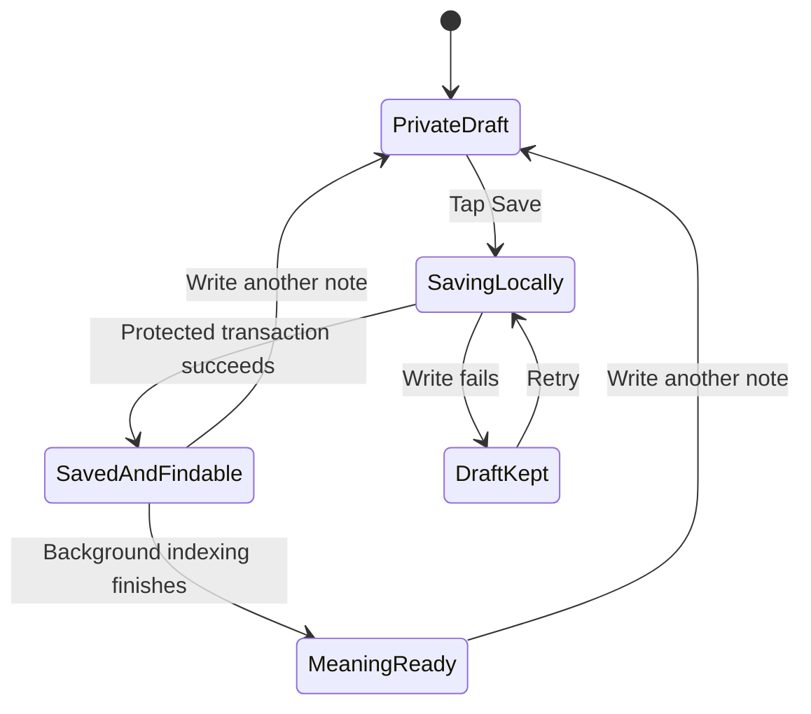
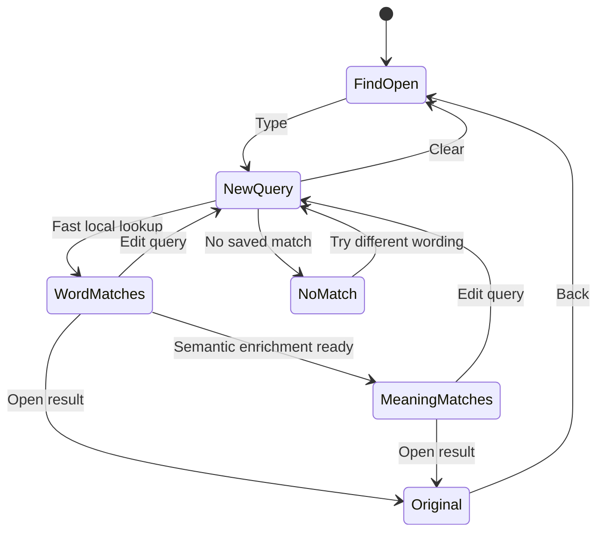

# Consumer state machines — proposed behavior

The human requested these state machines on 22 October 2026 before approving the revised execution plan. They describe the intended product; they do not imply the current development build implements protected storage, fast indexed retrieval, encrypted sync or managed chat. The [execution plan](../../.scratch/native-mvp/plans/consumer-backend-2026-10-22.md) remains a draft.

## Capture: acknowledge only a durable local save

At SavedAndFindable, word search can recover the original and an enabled sync queue contains the change. Semantic enrichment and networking continue independently. A save never waits for an assistant answer or for the other device. A failure preserves the draft.

## Recall: each query owns its results

An obsolete query finishing cannot overwrite the current query. Results resolve to current originals; deletion/editing invalidates old results and pending indexing. Insert into a host field remains explicit. Recall works offline and without Chat. The speed/quality budgets in the plan remain unmeasured targets; see the [current baseline](../verification/search-baseline-2026-10-22.md).

## Sync: preserve the local copy while waiting

```mermaid
stateDiagram-v2
    [*] --> LocalOnly
    LocalOnly --> Pairing: Enable private sync
    Pairing --> EncryptedQueue: Matching keys established; save change
    Pairing --> WaitingForKey: Matching key unavailable
    WaitingForKey --> Pairing: Pair or recover
    EncryptedQueue --> SendingCiphertext: Network and execution available
    EncryptedQueue --> OfflineQueue: Offline
    SendingCiphertext --> OfflineQueue: Interrupted
    OfflineQueue --> SendingCiphertext: Retry when available
    SendingCiphertext --> OnBothDevices: Peer verifies, decrypts, saves and indexes
    OnBothDevices --> EncryptedQueue: Another local change
```

The server receives ciphertext plus required opaque routing metadata. Missing keys never cause a replacement vault to overwrite inaccessible data. Conflicts, account changes, revocation and deletion are additional security substates required by ticket 05; this overview does not replace that full protocol design. Background execution has no fixed deadline. Capture/Recall remain local during network failure.

## Mac: compact Recall on the hotkey

```mermaid
stateDiagram-v2
    [*] --> OtherApp
    OtherApp --> NearFieldBar: Hotkey; permitted geometry available
    OtherApp --> CompactFallback: Hotkey; geometry unavailable
    NearFieldBar --> LiveResults: Type
    CompactFallback --> LiveResults: Type
    LiveResults --> OriginalPreview: Arrows and Return
    OriginalPreview --> OtherApp: Escape
    LiveResults --> OtherApp: Escape
    NearFieldBar --> OtherApp: Escape
    CompactFallback --> OtherApp: Escape
```

The Mac begins in Recall; the phone keyboard still begins in Capture. Read only host geometry for placement, with explicit Accessibility permission if chosen. Keep the panel on-screen and useful without that permission. Capture/Chat remain available and dismissal preserves drafts.

## Chat: availability and retention are explicit

```mermaid
stateDiagram-v2
    [*] --> ChatReady
    ChatReady --> RetainedQuestion: Send ordinary message
    RetainedQuestion --> AnswerWithSources: Assistant answers
    AnswerWithSources --> RetainedQuestion: Continue
    ChatReady --> TemporarySegment: Choose Temporary
    TemporarySegment --> TemporarySegment: Ask and receive answer; retain nothing
    TemporarySegment --> ChatReady: End Temporary; discard segment
    AnswerWithSources --> ForgottenLocally: Forget selected exchange and derived memory
    ForgottenLocally --> ChatReady: Continue
    ChatReady --> AssistantUnavailable: No usable on-device model
    AssistantUnavailable --> ChatReady: On-device assistant ready
    AssistantUnavailable --> CloudChoice: Consider cloud AI
    CloudChoice --> ChatReady: Explicit opt-in; supported cloud option ready
    CloudChoice --> AssistantUnavailable: Keep cloud AI off
```

A continuing ordinary conversation is attributed and retained; Temporary can read the vault without adding messages or derived memories. Forget removes the local exchange and derived material, then propagates deletion to paired devices when sync runs. External copies have a separate boundary. An unavailable assistant does not disable Capture/Recall. The app owns availability/setup; users do not operate an inference server. A reminder changes only after a validated deliberate action, with the executed result shown.
