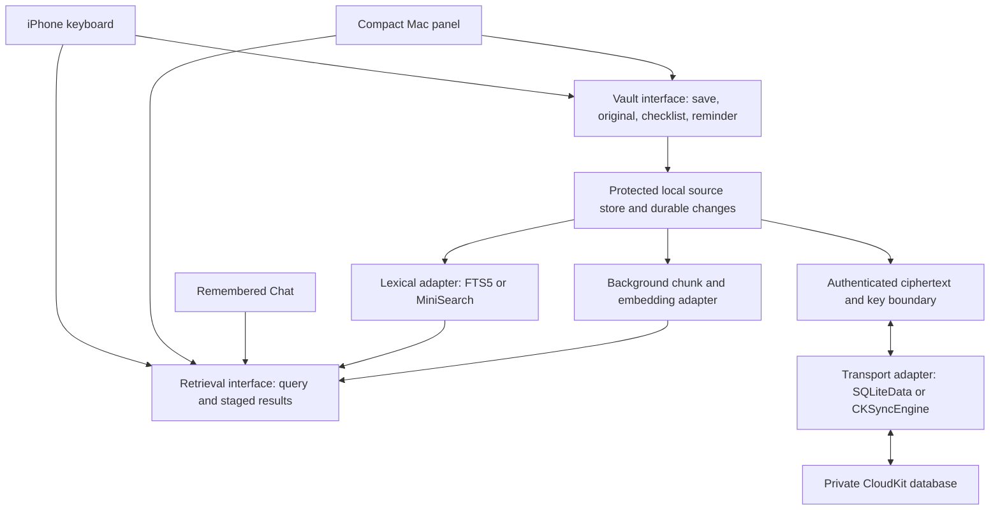

# Reuse-first recommendation

Reuse search, replication and typing components behind the existing app's interfaces. MiniSearch passed a native Mac feasibility probe; SQLiteData and SnipKey are promising pilot candidates. No complete replacement application was verified, and no production dependency was adopted.

Checked 22 October 2026. This recommendation refines the draft [consumer-backend plan](../../.scratch/native-mvp/plans/consumer-backend-2026-10-22.md). The human requested a state-machine walkthrough before approving its ticket breakdown; the [walkthrough](../design/consumer-state-machines.md) is available, but approval remains pending. Existing ticket statuses and approved test boundaries are unchanged.

## Proposed choices

| Need | First candidate / comparison | What we retain or implement |
| --- | --- | --- |
| Durable local vault | GRDB/SQLite; compatible encrypted configuration | Migration from JSON, shared-process coordination, source revisions, atomic outbox, protected indexes and Forget |
| Fast word/name/typo Find | MiniSearch via JavaScriptCore versus SQLite FTS5 | Query scheduling, filters, incremental consistency, snippets and native result rendering |
| Semantic understanding | Cached embeddings; evaluate existing NLEmbedding and compact multilingual encoder | Chunking/versioning, relevance judgments, hybrid ranking; exact vector search first, sqlite-vec/USearch if measurements justify them |
| Apple-device sync | SQLiteData's CloudKit engine; direct CKSyncEngine fallback | App ciphertext/key lifecycle, recoverable conflicts, account changes, deletion, extension lifecycle and real-device measurements |
| iPhone typing | Selected SnipKey key-plane code | Existing rich pad, routing, drafts/sizes, Find, Chat and reminders |
| Mac hotkey | Existing AppKit shell; Noty/Maccy patterns, optional KeyboardShortcuts | Compact live Find, optional focused-field placement, graceful permission fallback |

Primary-source evidence, licences and exclusions: [search engines](2026-10-22-reuse-search-engines.md), [sync engines](2026-10-22-reuse-sync-engines.md), [keyboard/hotkey clients](2026-10-22-reuse-keyboard-hotkey-clients.md). Model/runtime and source-protection details remain in the [retrieval report](2026-10-22-fast-private-retrieval.md) and [security report](2026-10-22-private-sync-security.md).

## Evidence achieved

The [MiniSearch probe](../verification/minisearch-native-probe-2026-10-22.md) compiled Swift plus JavaScriptCore and loaded an integrity-verified MiniSearch 7.1.0 bundle. The timed 10k synthetic run returned expected exact/prefix/typo/Hindi literal results with p95 about 0.12–3.81 ms across the tested successful queries. Startup was about 72 ms; building the fixture/index took about 355 ms. Serialization/reload and deletion passed. These cover the library bridge; they exclude application/UI, embeddings and a realistic diverse corpus.

Whole-process peak RSS was about 95 MiB while holding fixtures, serialized strings and two indexes. A real extension memory/cold-start comparison is required. The no-overlap paraphrase returned nothing, demonstrating the need for semantic retrieval alongside word matching. No new sync, client extraction or model-quality benchmark was completed.

## Proposed module boundaries

This diagram is a dependency proposal, without new product states. It omits the reminder/AI action details already specified in the walkthrough. Adapters are replaceable; shipping both lexical engines or several replication frameworks is unnecessary.

Search should remain immediately usable on the local copy while sync runs. iCloud can be the consumer's simple sync experience through CloudKit; an iCloud Drive folder is a different file workflow. SQLiteData's encrypted fields do not by themselves satisfy the unconditional content-privacy promise, and its default last-edit-wins policy needs recoverable source revisions around it. See [sync analysis](2026-10-22-reuse-sync-engines.md).

## Next executable checks

1. Compare FTS5 and MiniSearch through the approved retrieval seam, on identical realistic corpora and actual keyboard hardware; record query-to-visible-results time and memory. Keep model work outside rendering and evaluate semantic quality separately.
2. Compile a compatible SQLiteData release and prove ciphertext-only mutation round trips between two vaults, preserving concurrent content and deletion. Then verify signed Mac/iPhone behavior with real CloudKit. Stop if wrapper constraints obstruct the privacy/conflict contract and use the direct adapter.
3. Isolate a SnipKey typing adapter and compare it with the working keys, keeping the accepted workspace. Extract no telemetry or unrelated application services. Build the compact Mac panel against the same retrieval interface.

These are proposed integration checks for the pending plan, not newly published tickets. Rust remains available behind a measured engine boundary; there is no measured reason to rewrite the Swift shell or all backend logic. Reusing a library reduces engine work while retaining responsibility for the product's data, correctness and privacy promises.
