# Product statechart: Mind Machine as a person uses it

This chart describes what a person sees and does on the Mac pill and the iPhone keyboard. `docs/state-machines/software.md` describes the code underneath and lists where the two disagree.

Update this chart before changing any behaviour a person can see (see "State machines first" in `AGENTS.md`).

Sources: `docs/MVP-CORE.md` (approved scope, 23 October 2026), `docs/DESIGN.md` sections "Mac floating pill" and "Private replication and signing", `CONTEXT.md` terms Pad size and Typing destination, and the code at origin/main `c45031b` for current behaviour.

## How the chart is checked

The chart is a Mermaid `stateDiagram-v2` with parallel regions (the `--` separators). Each region is one thing that changes independently. A label that appears in two regions makes both regions move together in one step.

The pstack `statechart` skill turns a chart like this into a TLA+ model and runs TLC. The full chart is too large for that tool (more than 10 minutes, then stopped), so four slices run separately and are stored in `docs/state-machines/charts/`:

| Slice file | Regions | Result |
| --- | --- | --- |
| `check-mac.mmd` | Mac pill and panel | 8 states, all reachable |
| `check-access.mmd` | Keyboard access and note | 6 states, all reachable |
| `check-find.mmd` | Keyboard tab (with Find results), pad size, typing destination | 18 states, all reachable |
| `check-sync.mmd` | Sync on this device, Notes not yet in the cloud | 13 states, all reachable, rule `UpToDateWithWaitingNote` holds |

Command for one slice, from a scratch folder: `TLA2TOOLS=<path to tla2tools.jar> JAVA=<java> node .agents/skills/statechart/scripts/statechart.mjs from-chart <slice>.mmd --module <Name>`.

The first draft of the Find slice failed: "you tap a result" could happen on the Capture tab, because the result list sat in its own region. The result list now shares a region with the tabs, which removes that case. Regions cannot see each other's state, so a rule that needs two regions has to become one region. The chart carries one cross-region rule (sync, below).

The chart has no nested composite states. Mermaid's layout fails (`Cannot set properties of undefined (setting 'rank')`) when a composite state sits inside a parallel region, so the tabs, the Mac panel states and the keyboard-ready states are flat and repeat their exit edges.

## Chart

```mermaid
stateDiagram-v2
  state "Mind Machine as one person uses it" as App {
    state "Mac pill and panel" as Mac {
      state "Pill resting" as PillIdle
      state "Pill hovered, tooltip shows" as PillHover
      state "Pill being dragged" as PillDragging
      state "Pill hidden" as PillHidden
      state "Panel open on Capture" as CaptureTab
      state "Panel open on Find" as FindTab
      state "Panel open on Capture, pill hidden" as HiddenCaptureTab
      state "Panel open on Find, pill hidden" as HiddenFindTab
      [*] --> PillIdle
      PillIdle --> PillHover : you point at the pill
      PillHover --> PillIdle : you move the pointer away
      PillHover --> PillDragging : you press and drag the pill
      PillDragging --> PillIdle : you drop the pill
      PillHover --> CaptureTab : you click the pill
      PillIdle --> CaptureTab : you press the hotkey
      PillHover --> CaptureTab : you press the hotkey
      PillDragging --> CaptureTab : you press the hotkey
      CaptureTab --> FindTab : you switch to Find on the Mac
      FindTab --> CaptureTab : you switch to Capture on the Mac
      CaptureTab --> CaptureTab : you click the Soon tab
      FindTab --> FindTab : you click the Soon tab
      CaptureTab --> PillIdle : you press Escape
      CaptureTab --> PillIdle : you click another app
      CaptureTab --> PillIdle : you click the close button
      CaptureTab --> PillIdle : you press the hotkey again
      FindTab --> PillIdle : you press Escape
      FindTab --> PillIdle : you click another app
      FindTab --> PillIdle : you click the close button
      FindTab --> PillIdle : you press the hotkey again
      PillIdle --> PillHidden : you choose Hide pill
      PillHover --> PillHidden : you choose Hide pill
      PillHidden --> PillIdle : you choose Show pill
      PillHidden --> HiddenCaptureTab : you press the hotkey
      HiddenCaptureTab --> HiddenFindTab : you switch to Find on the Mac
      HiddenFindTab --> HiddenCaptureTab : you switch to Capture on the Mac
      HiddenCaptureTab --> HiddenCaptureTab : you click the Soon tab
      HiddenFindTab --> HiddenFindTab : you click the Soon tab
      HiddenCaptureTab --> PillHidden : you press Escape
      HiddenCaptureTab --> PillHidden : you click another app
      HiddenCaptureTab --> PillHidden : you click the close button
      HiddenCaptureTab --> PillHidden : you press the hotkey again
      HiddenFindTab --> PillHidden : you press Escape
      HiddenFindTab --> PillHidden : you click another app
      HiddenFindTab --> PillHidden : you click the close button
      HiddenFindTab --> PillHidden : you press the hotkey again
      HiddenCaptureTab --> CaptureTab : you choose Show pill
      HiddenFindTab --> FindTab : you choose Show pill
    }
    --
    state "iPhone keyboard access and note" as Access {
      state "Keyboard not added" as NotAdded
      state "Added, Full Access off" as NoAccess
      state "Ready, note pad empty" as NoteEmpty
      state "Ready, note being written" as NoteDrafting
      state "Ready, saved on this device" as NoteSaved
      state "Ready, save failed and draft kept" as NoteSaveFailed
      [*] --> NotAdded
      NotAdded --> NoAccess : you add the keyboard in Settings
      NoAccess --> NoteEmpty : you turn on Full Access
      NoteEmpty --> NoteDrafting : you type in the private pad
      NoteSaved --> NoteDrafting : you type in the private pad
      NoteDrafting --> NoteSaved : you save a note
      NoteDrafting --> NoteSaveFailed : the device cannot store the note
      NoteSaveFailed --> NoteDrafting : you keep editing the draft
      NoteEmpty --> NoAccess : you turn off Full Access
      NoteEmpty --> NotAdded : you remove the keyboard
      NoteDrafting --> NoAccess : you turn off Full Access
      NoteDrafting --> NotAdded : you remove the keyboard
      NoteSaved --> NoAccess : you turn off Full Access
      NoteSaved --> NotAdded : you remove the keyboard
      NoteSaveFailed --> NoAccess : you turn off Full Access
      NoteSaveFailed --> NotAdded : you remove the keyboard
      NoAccess --> NotAdded : you remove the keyboard
    }
    --
    state "iPhone keyboard tab" as Tab {
      state "Capture tab" as TabCapture
      state "Find tab, result list" as ResultList
      state "Find tab, one original open" as OriginalOpen
      [*] --> TabCapture
      TabCapture --> ResultList : you switch to Find on the phone
      ResultList --> OriginalOpen : you tap a result
      OriginalOpen --> ResultList : you tap Back to results
      ResultList --> TabCapture : you switch to Capture on the phone
      OriginalOpen --> TabCapture : you switch to Capture on the phone
      ResultList --> TabCapture : the keyboard reopens
      OriginalOpen --> TabCapture : the keyboard reopens
    }
    --
    state "iPhone pad size" as Size {
      state "Minimised pad" as SizeMinimised
      state "Default pad" as SizeDefault
      state "Expanded pad" as SizeExpanded
      [*] --> SizeDefault
      SizeDefault --> SizeExpanded : you tap Size
      SizeExpanded --> SizeMinimised : you tap Size
      SizeMinimised --> SizeDefault : you tap Size
    }
    --
    state "iPhone typing destination" as Dest {
      state "Typing into the private pad" as ToPad
      state "Typing into the app" as ToApp
      [*] --> ToPad
      ToPad --> ToApp : you tap the app text field
      ToPad --> ToApp : you tap Insert original into app
      ToApp --> ToApp : you tap Insert original into app
      ToApp --> ToPad : you tap the private pad
      ToApp --> ToPad : the keyboard reopens
    }
    --
    state "Sync on this device" as Sync {
      state "Local only, no key paired" as NoKey
      state "Up to date" as UpToDate
      state "Saved here, waiting to upload" as Waiting
      state "Syncing privately" as Syncing
      state "Offline, changes wait" as Offline
      state "iCloud signed out" as SignedOut
      state "Paused, notes kept on device" as Paused
      [*] --> NoKey
      NoKey --> Waiting : you pair the sync key
      Waiting --> Syncing : sync starts
      Syncing --> UpToDate : the cloud confirms every note
      Syncing --> Waiting : the upload fails
      Syncing --> Waiting : you save a note
      UpToDate --> Waiting : you save a note
      Waiting --> Waiting : you save a note
      Offline --> Offline : you save a note
      NoKey --> NoKey : you save a note
      SignedOut --> SignedOut : you save a note
      Paused --> Paused : you save a note
      Waiting --> Offline : the network drops
      Syncing --> Offline : the network drops
      UpToDate --> Offline : the network drops
      Offline --> Waiting : the network returns
      Syncing --> SignedOut : iCloud is signed out
      Waiting --> SignedOut : iCloud is signed out
      SignedOut --> Waiting : you sign back in to iCloud
      Syncing --> Paused : iCloud account changes
      Syncing --> Paused : the cloud data cannot be read
      Paused --> Waiting : the next sync retries with the original account
    }
    --
    state "Notes not yet in the cloud" as Outbox {
      state "None waiting" as OutboxEmpty
      state "At least one waiting" as OutboxFull
      [*] --> OutboxEmpty
      OutboxEmpty --> OutboxFull : you save a note
      OutboxFull --> OutboxFull : you save a note
      OutboxFull --> OutboxEmpty : the cloud confirms every note
    }
  }
  [*] --> App
  %% never UpToDateWithWaitingNote: Up to date & At least one waiting -- The phone never says "Up to date" while a saved note has not reached the cloud.
```

## Regions, states and events

### Mac pill and panel

| State | What the person sees |
| --- | --- |
| Pill resting | A 60 x 28 pt capsule at its remembered position, bottom centre by default. |
| Pill hovered, tooltip shows | Tooltip "Mind Machine: click or press ⌃⌥Space". No other visual change. |
| Pill being dragged | The pill follows the pointer after a 4 pt movement. |
| Pill hidden | No window. Menu-bar item still shows. |
| Panel open on Capture / Panel open on Find | A 540 x 440 pt panel with tabs Capture ⌘1, Find ⌘2 and a dashed disabled "Soon" slot. |
| Panel open on Capture / Find, pill hidden | The same panel, opened by the hotkey while the pill is hidden. Show pill keeps the tab. |

Events: point at / leave the pill, press and drag, drop, click the pill, hotkey ⌃⌥Space (toggles), Escape, click another app, close button, Hide pill, Show pill, switch tab, click the Soon tab (does nothing).

Guards:
- Expanding always opens Capture; drafts stay in the shared model.
- The Soon slot is never selectable. It has no state of its own: clicking it leaves the panel as it is.
- A tab change moves the caret into the note editor (Capture) or the query field (Find).
- The panel opens centred on the pill, grows up from a pill in the lower half of the display and down from one in the upper half, and is clamped into the display's usable area.

Invariants:
1. The collapsed pill never takes keyboard focus from the app underneath.
2. A drag never opens the panel; a click without 4 pt of movement does.
3. Hiding the pill never prevents the hotkey from opening the panel, and closing the panel returns to hidden.
4. The pill position survives relaunch; if its display is gone the pill uses the default spot and returns when the display returns.

### iPhone keyboard access and note

| State | What the person sees |
| --- | --- |
| Keyboard not added | Mind Machine is absent from the keyboard list. The companion app explains how to add it. |
| Added, Full Access off | A message that the shared vault is unavailable. Capture is blocked. |
| Ready (note pad empty, note being written, saved on this device, save failed with draft kept) | The private pad and Save. "Saved on this device" appears only after the durable write. |

Events: add the keyboard, turn Full Access on or off, remove the keyboard, type, Save, the device cannot store the note.

Guards: Save works only in the Ready states. A failed save keeps the draft. Host-app typing is never saved as a note.

Invariants:
1. "Saved on this device" means the note and its search entry are on disk.
2. A person cannot write a note that cannot be saved (Full Access off blocks typing in the pad). The code allows it today; see software.md, mismatch P1.

### iPhone keyboard tab, pad size, typing destination

- Tab: Capture or Find. Find contains the result list and one open original. The keyboard opens on Capture every time it appears. The release has no third tab on the phone.
- Pad size: Minimised, Default, Expanded (`CONTEXT.md` terms; the brief calls them small, default, expanded). One Size button cycles Default → Expanded → Minimised → Default. Size does not change the draft, the tab or the typing destination.
- Typing destination: private pad or the host app. "Insert original into app" and tapping the app's text field send keys to the app. Tapping the private pad or reopening the keyboard sends them back.

Invariants:
1. Changing size, tab or destination never clears a draft.
2. Only the explicit Insert action writes a saved original into the host app.
3. An open original appears only on the Find tab (enforced by nesting it there).

### Sync on this device, and notes not yet in the cloud

| State | What the person sees |
| --- | --- |
| Local only, no key paired | "Local vault · pair private sync in setup". |
| Up to date | "Private sync up to date". |
| Saved here, waiting to upload | "Saved locally · sync pending". |
| Syncing privately | "Syncing privately…". |
| Offline, changes wait | Saves still work; uploads wait. |
| iCloud signed out | "Sign into iCloud and enable iCloud Drive to sync. Local saves remain available." |
| Paused, notes kept on device | "Sync paused" with the reason. Local notes stay. |

Events: pair the key, sync starts, the cloud confirms, the upload fails, save, network drops / returns, iCloud signed out / back in, iCloud account changes, cloud data cannot be read, relaunch with the original account.

Guards: Sync starts only after a key is paired and iCloud is available. A save during a sync moves the badge back to waiting.

Invariants:
1. **Never "Up to date" while a saved note has not reached the cloud.** Checked by TLC (`UpToDateWithWaitingNote`).
2. Saving never waits for the network.
3. Signing out or switching iCloud accounts never erases the local vault.
4. Deleting one displayed conflict copy retains other copies and unseen concurrent edits. Identical edits fold into one displayed original. Incomplete revisions wait for their parents before becoming visible. Two devices that stop editing show the same notes (checked by `spec/MindMachineSync.tla`, property `Convergence`).

## Known gaps in this chart (decisions needed)

| ID | Gap | Why it matters |
| --- | --- | --- |
| G1 | "Paused" has an exit for an account change only (return to the original account). Unreadable cloud data and a removed cloud zone have no exit in the chart. | A paused device stays paused. Needs a product decision: retry, skip the bad record, or reset sync. |
| G2 | A person who legitimately moves to a new Apple ID has no exit from "Paused". | Sync stays off for that vault. |
| G3 | No state for the first download after pairing. `docs/MVP-CORE.md` asks for download and index progress and a clear incomplete state. | A second device can look empty while the backlog is still arriving. |
| G4 | The phone has no Copy action and the Mac panel has no Insert or Copy action. `docs/MVP-CORE.md` promises "Copy, Insert or Open". | Reuse of an original on the Mac needs select-and-copy by hand. |
| G5 | Reminders and chat are outside the approved MVP scope but still exist in code and in the keyboard. They are left out of this chart. | Add them when they return to scope. |
