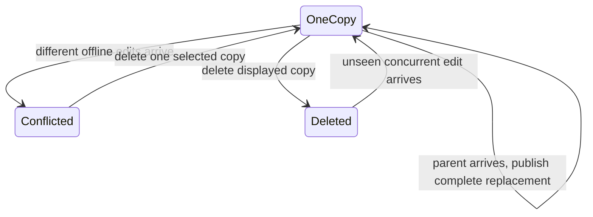
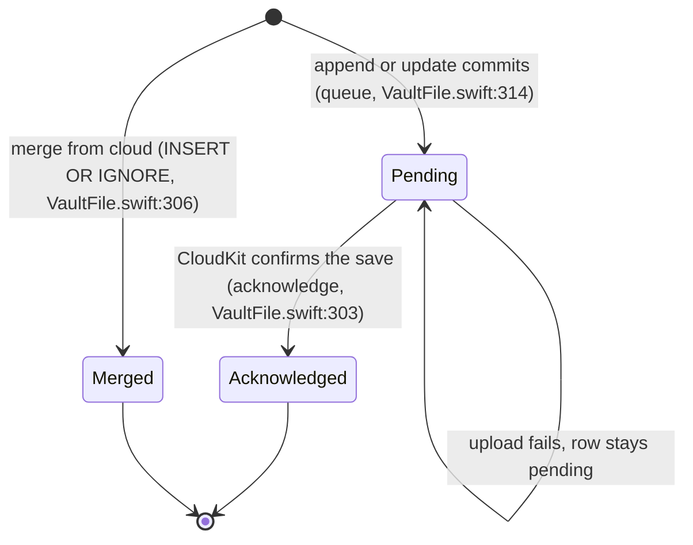
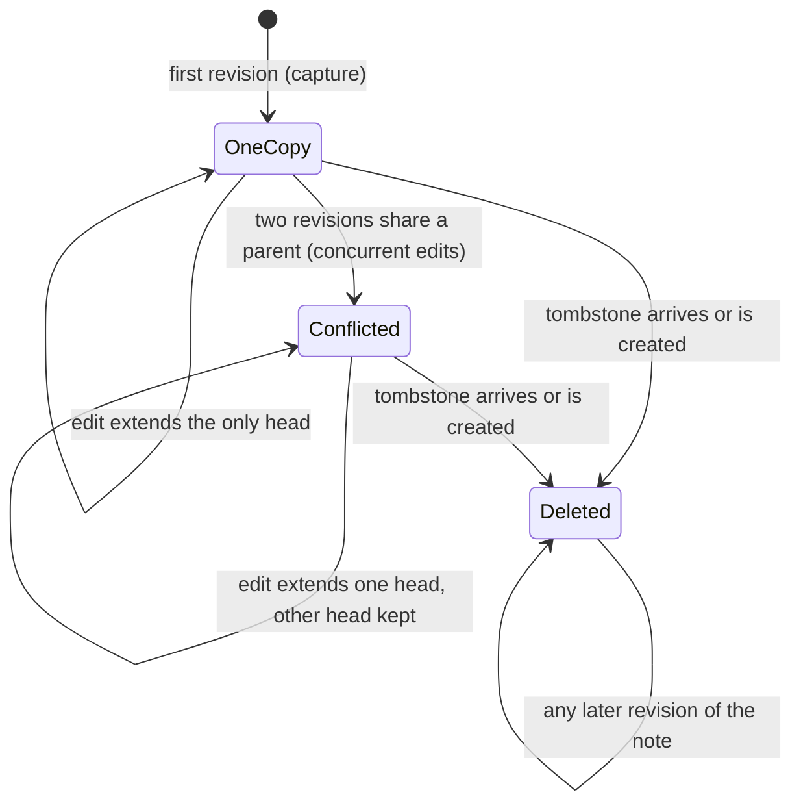
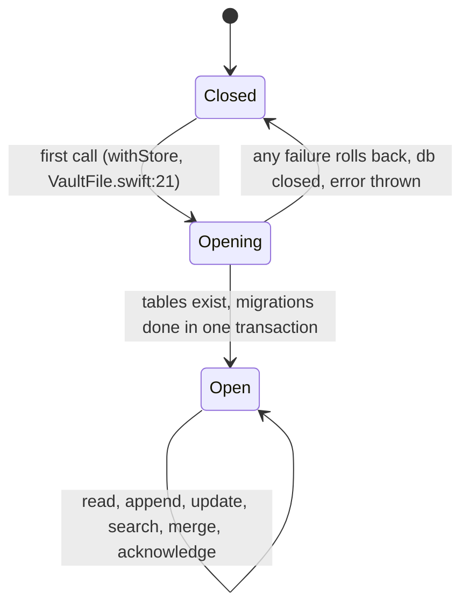
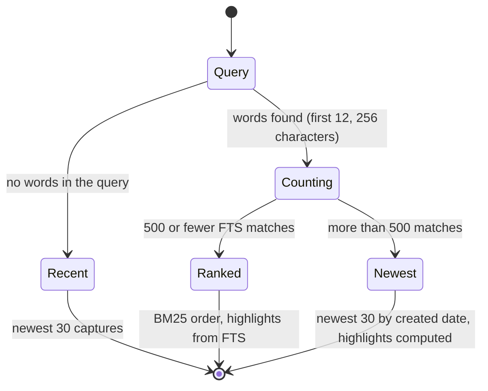
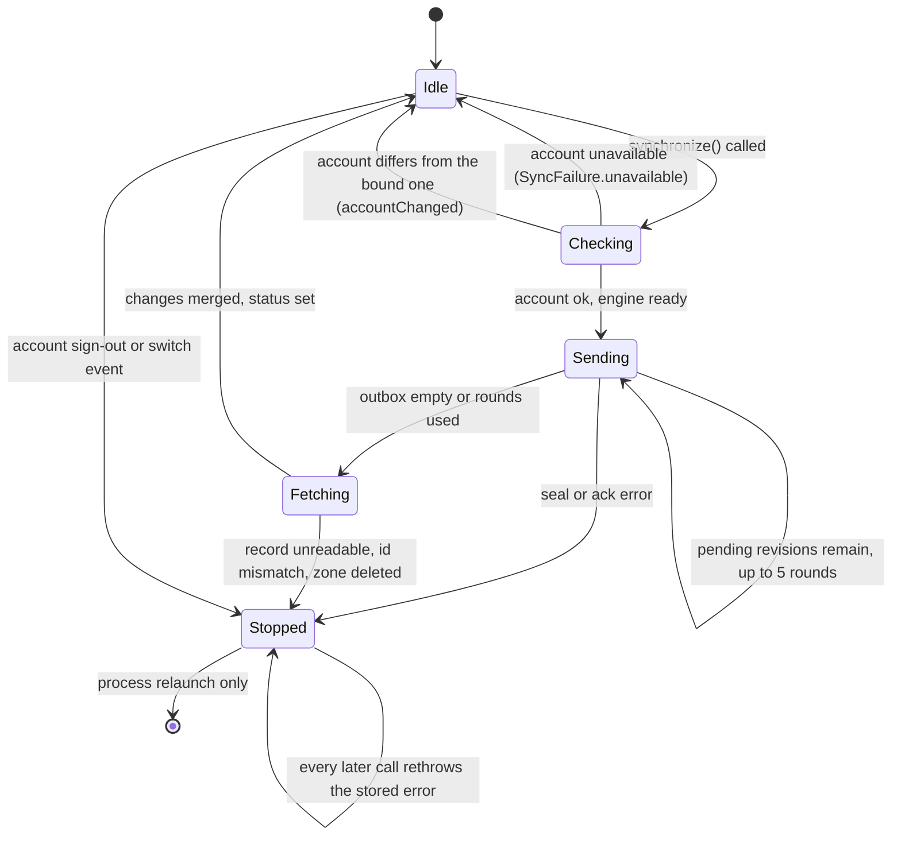
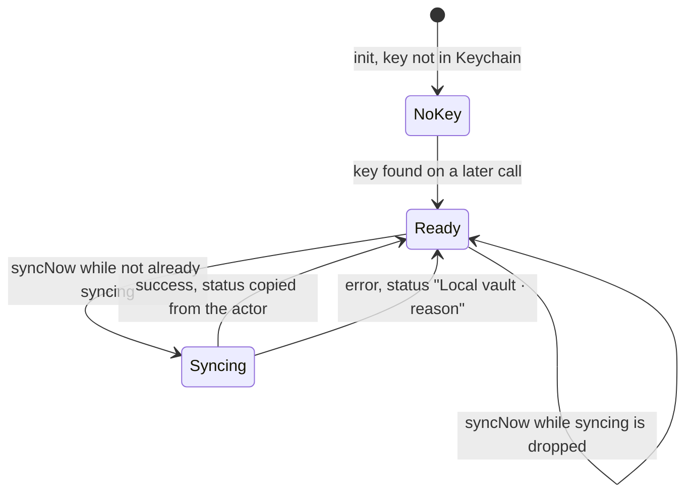
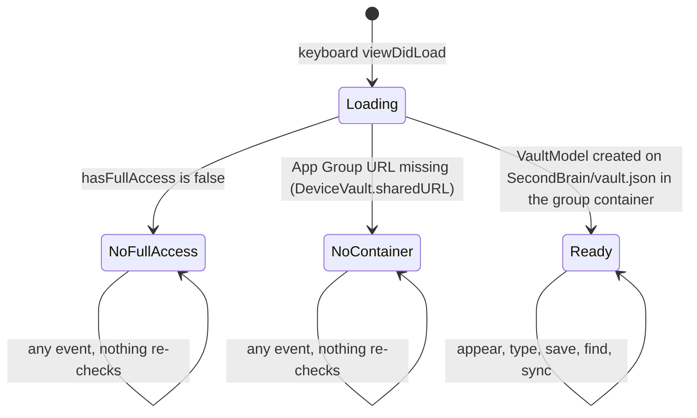
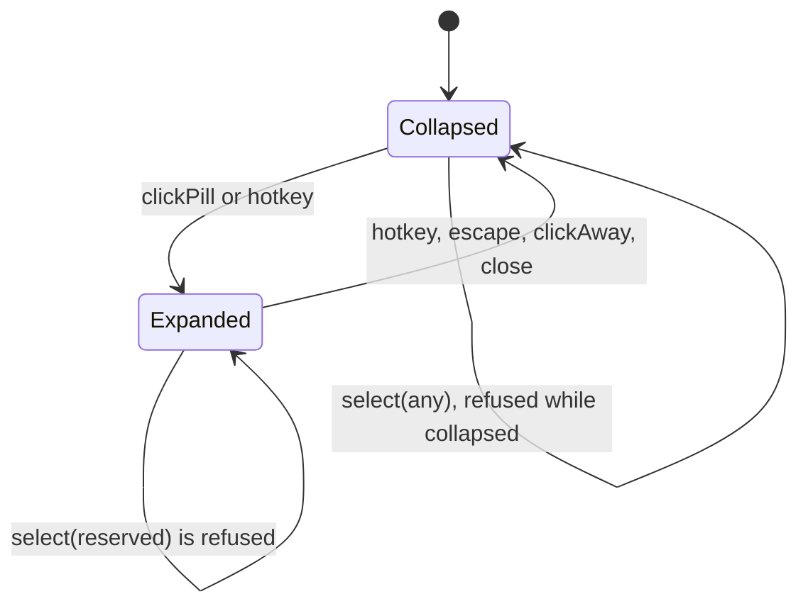

# Core state changes on overnight-core

This branch selectively carries PR #2's model and charts without merging that branch. The historical audit below describes `c45031b`; this section describes the implemented transitions and supersedes that audit for core behavior.

Before implementation: the agreed visible projection keeps a complete original until a replacement has its full parent chain. Equivalent concurrent heads appear once; editing/deleting that displayed copy names all equivalent heads. A delete names only its selected copy, so concurrent unseen edits and different conflict copies survive. All revisions remain immutable and durable, including revisions awaiting parents.

The deterministic Swift regressions replay the four TLC stories through `VaultFile`. The model abstracts all capture fields into a value; Swift equivalence compares the full normalized capture, including formatting, checklist IDs/ticks and original creation time. Stable per-branch display IDs for different conflicts remain the M11 follow-up.

---

# Software statecharts: the code underneath

This file describes the states and events in the code at origin/main `c45031b` (23 October 2026) and lists where the code disagrees with `docs/state-machines/product.md`, where a state has no exit and where an event has no handler. Swift is not installed on the Linux box that wrote this file, so every claim comes from reading the source. Nothing here was run against the app.

Paths are under `native/` unless stated. Line numbers refer to `c45031b`; the line numbers move, the names do not.

Update the relevant chart before changing sync, shared storage, search or window behaviour (see "State machines first" in `AGENTS.md`). A change to the revision, sync or shared-vault code must also keep `spec/run-tlc.sh` green.

## 1. Vault store: revisions and the note projection

`Sources/MindMachineCore/VaultFile.swift` keeps one SQLite database per device (WAL, `synchronous=FULL`, `fullfsync`). Every write is one `BEGIN IMMEDIATE` transaction (`transaction`, line 354), so two processes that share the file take turns. The tables are `captures` (what Recall shows), `notes` (FTS5 text index), `revisions` (immutable history plus a `pending` flag = the upload outbox), `projections` (which revision backs which visible capture), `spellings` and `metadata`.

A **revision** (`NoteRevision.swift`) has an id, a note id, an optional capture (nil = tombstone) and parent revision ids. It never changes after it exists.

### Revision lifecycle

Guards: `pendingRevisions` returns at most 100 rows, newest first (line 301). `merge` never changes an existing row, so a revision that is both pending and fetched keeps `pending=1` until its own acknowledge.

Invariants: a revision is never edited or deleted from the table; `Saved` is shown only after the commit.

### Note projection (what Recall shows for one note)

`materialize` (line 336) rebuilds a note's visible captures from its revisions after every local write and every merge.

Rules in the code:
- Heads are revisions that no other present revision lists as parent (`heads`, line 322). A head whose parent has not arrived yet is still a head.
- Any tombstone for the note hides every head (`guard !all.contains(where: { $0.capture == nil })`, line 345).
- The head that sorts first by id string is shown with the note id; every other head is shown with its own revision id (line 348). Which head holds the note id can change when a new head arrives.
- A removed capture creates a tombstone whose parents are all current heads of the note, whichever copy was removed (`update`, lines 134-138).
- Editing a displayed copy creates a revision whose parent is that copy's revision (`identity`, line 329).

Exits: `Conflicted` has no way back to `OneCopy`: nothing merges heads, and removing a copy deletes the whole note. `Deleted` has no exit by design (a test requires that a stale replica cannot resurrect a note, `Tests/MindMachineCoreTests/ReplicationTests.swift:31`).

Reachability today: `update` is called with a checklist toggle (`VaultModel.setItem`), a reminder change or chat retention. No screen removes a capture, so `Deleted` is reachable only from tests and future features. Only checklist toggles edit note content, so `Conflicted` needs concurrent toggles on two devices.

### Store open and migration

Exit check: `Closed` after a failure retries on the next call. A damaged legacy JSON file fails every open until a person repairs it; this is deliberate ("a failed migration is rolled back, so retry never mistakes a damaged source for empty", line 49).

## 2. Indexer and search

`write` (line 277) replaces the `captures` row, the `notes` FTS row (same rowid) and the `spellings` rows for words of 4+ letters in the same transaction as the revision. `remove` (line 285) deletes the `captures` and `notes` rows. The index therefore always matches `captures`. `materialize` removes and rewrites every capture of the note it rebuilds.

Guards: open-task filtering runs inside SQL before the page limit (line 163). A word of 4+ letters with no vocabulary prefix match gets one-edit candidates from `spellings` (line 179).

## 3. CloudKit sync and conflict handling

`Sources/MindMachineCore/PrivateCloudSync.swift` is an actor that wraps `CKSyncEngine` (automatic sync off). One instance exists per process (app, keyboard, Mac). Each has its own engine state and cursor, stored in the shared database under `sync.engine.<bundle id>`. They share the outbox (`revisions.pending`).

Events and handling (`handleEvent`, line 62):

| Event | Handling | Gap |
| --- | --- | --- |
| `stateUpdate` | Stores the engine state under this process's key. | None found. |
| `accountChange` signOut / switchAccounts | Sets `stopped`. | See S1. |
| `fetchedRecordZoneChanges` | Decrypts each record, checks its id, calls `merge` in one transaction. Any bad record throws before `merge`, so none of the batch is stored. | S1 (poison record). |
| `fetchedRecordZoneChanges` deletions | Throws `remoteReset`. | S1. |
| `fetchedDatabaseChanges` zone deleted | Throws `remoteReset`. | S1. |
| `sentRecordZoneChanges` saved | `acknowledge`. | None. |
| `sentRecordZoneChanges` `serverRecordChanged` | Decrypts both records, accepts only if equal, acknowledges, removes the pending save. This is the duplicate-upload path between processes. | None found. |
| `sentRecordZoneChanges` `zoneNotFound` | Re-creates the zone and re-queues the record. | None found. |
| `sentRecordZoneChanges` any other error | Sets a status string; the row stays pending. | Network loss is not a named state (M5). |
| other events (`willFetchChanges`, `sentDatabaseChanges`, ...) | Ignored (`default: break`). | Fine. |

Conflict handling is structural. Two edits of one note become two revisions that share a parent; `materialize` shows both. There is no merge step. Identical content is not folded (T1).

### Sync driver in `VaultModel`

`Sources/MindMachineUI/VaultModel.swift` starts `syncNow` at init (line 50), every 15 seconds (line 53), after every `change` (line 114), after `saveCapture` (line 142) and on `activateCapture` (line 92).

Guards: `syncNow` returns at once when `syncing` is true (line 63). A drop is not queued. The next trigger is the 15 s timer or the next activation. The signed-out and stopped cases leave `sync` in place, so the actor stays stopped.

## 4. App Group shared container between app and keyboard

Files: `Apps/Keyboard/KeyboardViewController.swift:57-75`, `Apps/Shared/DeviceVault.swift`, `Apps/*/Vault.entitlements`.

- App and keyboard open the same SQLite file in the group container (`SecondBrain/vault.json` → `vault.sqlite`). Separate processes take turns through SQLite locks with a 5 s busy timeout (line 34). A longer wait fails the write with "Could not save"; the draft stays.
- The keyboard model loads only its 100 newest captures (`captureLimit`, VaultModel line 43) but searches the full file.
- The Mac uses `Application Support/SecondBrain/vault.json` in its own sandbox (`VaultModel` line 45). Its entitlements list the App Group; nothing reads it.
- Reminders and chat messages live in the `vault` metadata row of each device and never sync (`merge` handles captures only; stated in `docs/DESIGN.md`).
- The keyboard writes `keyboard-memory.txt` beside the vault for the companion app. This is the only non-SQLite file.

## 5. Mac panel and window lifecycle

`Pill/Sources/MindMachinePill/PillState.swift` is the only logic in the product that is a real state machine in code: `PillState` (phase `collapsed | expanded(capture | find | reserved)` plus `pillShown`) with seven events. `Apps/Mac/PillController.swift` applies each transition to one `NSPanel`.

Window facts the controller adds (`PillController.swift`):
- The panel is key only while expanded (`allowsKey`, lines 149 and 179). Collapse sets it back after the animation.
- A generation counter (line 44) makes a superseded animation's completion do nothing (line 193). Reversing during an animation is therefore safe.
- Click-away uses a global mouse-down monitor (line 256) and `windowDidResignKey` (line 245), which ignores key changes to another window of this app.
- Dragging is outside `PillState`: `PillHandleView` (`Apps/Mac/PillPanel.swift:82-113`) and `PillDrag` (`PillGeometry.swift:135`). A move updates `pillFrame`; a drop saves the centre in `PillPreferences`.
- Display changes re-resolve the pill position (line 299). Space changes and wake re-order the window front (line 313).
- The hotkey is registered once at launch (`MindMachineMac.swift:66-70`). A failure sets `model.error`; there is no retry.

Exit check: every `Expanded` state has four exits (hotkey, Esc, click-away, close). `Collapsed` with `pillShown == false` still opens by hotkey and returns to hidden.

## 6. Where the code and the product chart disagree

| ID | Product chart says | Code does | Where |
| --- | --- | --- | --- |
| M1 | With Full Access off, Capture is blocked. | The full keyboard UI loads. Save is disabled but typing in the pad works, and the text is never stored. A person can write a note that cannot be saved. | `KeyboardViewController.swift:59-65`, `259-260`, `280` |
| M2 | Turning Full Access on makes the keyboard ready. | The check runs once in `viewDidLoad`. Nothing re-checks when the keyboard reappears. | `KeyboardViewController.swift:62`, `93-102` |
| M3 | Naming: Minimised, Default, Expanded (`CONTEXT.md`). | Button text says "Min" / "Default" / "Expanded". | `KeyboardViewController.swift:518` |
| M4 | The phone shows sync states. | The keyboard never displays `syncStatus`. Only the Mac panel and companion do. `docs/DESIGN.md` says pending writes keep a visible pending status. | `KeyboardViewController.swift:66-72`, `Sources/MindMachineUI/WorkspaceView.swift:49` |
| M5 | "Offline, changes wait" is a state. | There is no network monitor. Offline shows as a generic status string: `Sync waiting: <error>` from the actor, then `Local vault · <error>` from the model. | `PrivateCloudSync.swift:59`, `VaultModel.swift:80` |
| M6 | "iCloud signed out" returns to waiting when the person signs back in. | A sign-out event stops the actor for the rest of the process. Sign-in alone does not restart it. | `PrivateCloudSync.swift:72`, `29` |
| M7 | Hover is a state. | There is no hover handling. The only hover feedback is the system tooltip. | `Apps/Mac/PillRootView.swift` (`handle.toolTip`) |
| M8 | Dragging is a state of the pill. | Dragging is not in `PillState`, so its tests do not cover drag with hotkey, Esc or hide. A hotkey during a drag expands the panel and hides the handle that holds the drag state; whether the drop is delivered is not tested. | `PillPanel.swift:82-113`, `PillController.swift:151` |
| M9 | MVP-CORE: Copy, Insert or Open. | Insert exists only on the phone. Copy exists nowhere. The Mac shows selectable text. | `KeyboardViewController.swift:352-363`, `WorkspaceView.swift` |
| M10 | MVP-CORE: first pairing shows download and index progress. | One status string. No progress or incomplete state. | `VaultModel.swift:75-77` |
| M11 | A conflicted note shows two copies; each keeps its own identity. | The note id moves between copies when a new head sorts before the current first head. A reminder or an open original that holds the old id then points at the other copy's text. Reached only through concurrent checklist toggles. Read from the code, not run. | `VaultFile.swift:325`, `348` |

## 7. States with no exit and events with no handler

| ID | Finding | Where |
| --- | --- | --- |
| S1 | `stopped` has no in-process exit. `VaultModel` keeps the same actor for the process lifetime. For an unreadable record or a deleted cloud zone, relaunch retries from the same cursor, meets the same record or the same deletion and stops again. One bad record blocks every later record on that device. | `PrivateCloudSync.swift:17`, `29`, `72`, `85-87`, `112-116`; `VaultModel.swift:69-73` |
| S2 | A device bound to one iCloud account refuses every other account forever. There is no reset, no re-home and no message that says how to leave the state. | `VaultFile.swift:293-299`, `PrivateCloudSync.swift:33-34` |
| S3 | `syncNow` called while another sync runs is dropped, not queued. The note waits for the 15 s timer or the next activation. In the keyboard this needs the extension to stay alive. | `VaultModel.swift:63`, `PrivateCloudSync.swift:28` |
| S4 | The engine's pending list can hold a revision that another process already acknowledged. The batch filter skips it, so nothing is sent, and the stale entry stays in that process's state. No harm found. | `PrivateCloudSync.swift:122-132` |
| S5 | Unhandled event: Full Access toggled while the keyboard is loaded (M2). | `KeyboardViewController.swift:62` |
| S6 | Unhandled event: hotkey registration fails. The error is stored in `model.error` and shows only when the panel is open. No retry. | `MindMachineMac.swift:70` |
| S7 | Unhandled event: iCloud account sign-in after a sign-out (M6). | `PrivateCloudSync.swift:70-74` |

## 8. Model-checked rules for sync and the shared vault

`spec/MindMachineSync.tla` models one note moving between a phone vault (two writers: app and keyboard) and a Mac vault through one CloudKit zone, with up to 4 revisions, any interleaving, any delivery order and one process crash. `spec/run-tlc.sh` runs 13 configs; each states its expected result on its first line. TLC 2.19 (tla2tools 1.7.4), Java 21, run on 2026-10-23 against `c45031b`.

| Rule (plain words) | Shipped code | Ticket |
| --- | --- | --- |
| Deleted copies stay deleted, whatever order revisions arrive in. | holds | |
| Two devices that stop editing end up with the same notes, and every revision either holds reaches the other (bound 3 revisions, fair sync). | holds | |
| A note a person never deleted does not vanish from Recall. | **breaks** (T3, T2) | `.scratch/state-machines/issues/02`, `03` |
| Deleting one copy of a conflicted note keeps the other copy. | **breaks** (T2) | 02 |
| A delete does not discard an edit the deleter never saw. | **breaks** (T3) | 03 |
| Recall never shows two identical copies of one note. | **breaks** (T1) | 01 |
| Recall never shows an older version beside its newer one. | **breaks** (T4) | 04 |
| Upload that acknowledges before the cloud save (deliberately broken variant). | breaks, as intended | proves the check can fail |

- **T1** Both devices make the same edit offline. After sync the note shows twice.
- **T2** A tombstone lists every head as parent, so removing one copy hides all copies.
- **T3** A tombstone hides revisions its author never had.
- **T4** `pendingRevisions` sends newest first, so a revision can arrive before its parent and the parent shows as a second copy until it arrives.

Good news from the same run: with the Ancestry tombstone rule, identical-head folding and parents-first upload, every rule above holds (`fixed-safe`, `fixed-converges`). Without parents-first upload, T4 stays (`fixed-without-parents-first-NoStaleCopyBesideNewer`). Every counterexample for a lost note goes through a delete. The lost-note rule has no counterexample made only of captures, edits, uploads, fetches, acknowledgements and crashes within the bound.

What the model leaves out: encryption and keys, account changes and the stopped state (S1, S2), the 100-row batch limit, SQLite busy errors, more than one note, reminders and chat, the real CloudKit service, and the Swift code itself. A pass covers the model.
